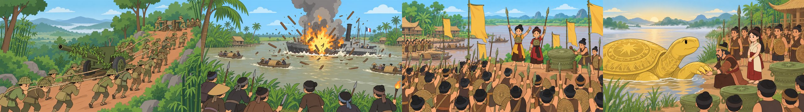
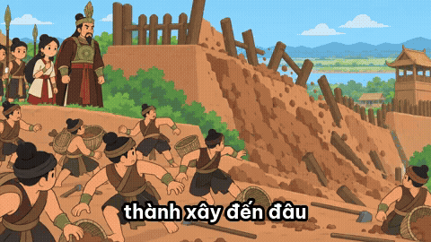
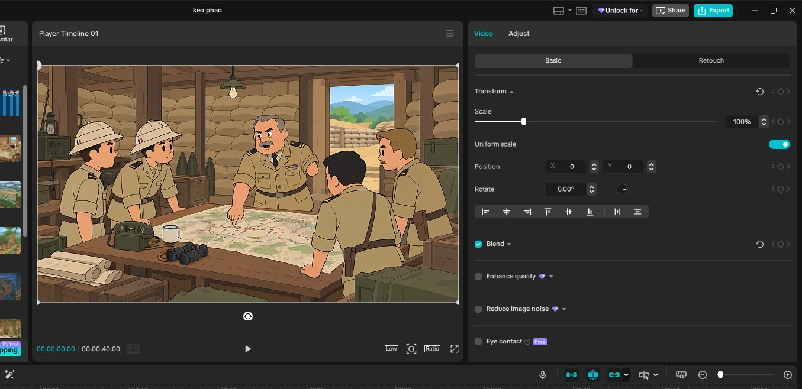

# history-capcut

Skill cho Claude Code: đưa 1 dòng ý tưởng lịch sử, nhận về một project CapCut desktop đã dựng sẵn timeline. Claude tra nguồn, viết kịch bản, làm voice, gen mỗi câu thoại một ảnh hoạt hình 2D, rồi ghi thẳng file draft của CapCut. Bạn mở CapCut là thấy ảnh có zoom, phụ đề, voice, nhạc, SFX nằm đúng chỗ, không kéo thả gì.



<p>
  
</p>

## Kết quả mỗi video

| | |
|---|---|
| Độ dài thử nghiệm | 52-82 giây, 15-20 câu |
| Ảnh | mỗi câu 1 ảnh riêng, 1920x1080, không ảnh nào dùng lại giữa các câu |
| Phụ đề | 2-5 chữ một dòng, chạy theo mốc từng chữ của giọng đọc, số hiện bằng chữ số và tô vàng |
| Chuyển động | zoom vào/ra, lia trái/phải xoay vòng; punch-in đúng các nhịp mạnh của câu chuyện |
| Âm thanh | voice, nhạc nền 6%, whoosh khi đổi cảnh, impact/riser ở nhịp mạnh, chuẩn hoá âm lượng |
| Chi phí ảnh | khoảng 15 ảnh tốn 1% hạn mức 5 giờ của gói ChatGPT Plus qua Codex CLI |

Các video đã làm, kèm kịch bản, nguồn, mô tả cảnh: [`examples/`](examples/).



## Quy trình

```
ý tưởng → sources.md → vo.txt → voice + mốc từng chữ → mỗi câu 1 ảnh → export/
        → project CapCut dựng sẵn timeline
```

1. **Nguồn.** Claude tra Wikipedia tiếng Việt, ghi fact dùng được và các chỗ nguồn chép lệch nhau. Truyền thuyết được tách riêng và mở bằng "Tương truyền", "Sử cũ chép". Con số chưa chắc thì không đưa vào lời đọc.
2. **Kịch bản.** Mỗi dòng một câu, mỗi câu một cảnh.
3. **Voice.** vivibe (API `api.lucylab.io`) đọc tiếng Việt, faster-whisper lấy mốc thời gian từng chữ.
4. **Ảnh.** Codex CLI gọi tool `image_gen` của gói ChatGPT đang đăng nhập, không cần API key ảnh. Style khoá bằng một file luật hình theo thời kỳ cộng ảnh mốc.
5. **CapCut.** Ghi thẳng `draft_content.json`, media pool, danh sách project.


## Cài đặt

Cần Windows, CapCut desktop, Python 3.11+, Node 18+, ffmpeg, Codex CLI đã `codex login` bằng tài khoản ChatGPT, và một key vivibe.

```bash
pip install pillow numpy faster-whisper
```

Chép thư mục này vào `.claude/skills/history-capcut/` của project bạn. Tạo `.env` ở gốc project:

```
VIVIBE_API_KEY=...
VIVIBE_VOICE=...
HC_MUSIC_FILE=D:/music/bai-nhac.mp3        # tuỳ chọn
HC_SFX_DIR=D:/sfx                           # tuỳ chọn, tên file xem new_project.py
```

Rồi nói với Claude Code: *"làm video lịch sử về trận Chi Lăng"*. Claude đọc `SKILL.md` và chạy hết. Chạy tay từng bước cũng được, lệnh nằm trong `SKILL.md`.

## Giới hạn

- Định dạng draft CapCut không công khai, skill này viết theo bản desktop v189 (2026). CapCut đổi định dạng thì phải cập nhật `template/script/capcut_template.json`.
- CapCut phải tắt hẳn lúc ghi project, không thì khi đóng nó ghi đè mất.
- Model ảnh vẫn có lúc vẽ sai trang phục, sai thời, hay vẽ thêm chi tiết lạ (hay gặp nhất: đồ Nhật lọt vào cảnh Việt). Xem lại ảnh trước khi đăng; ảnh nào lỗi thì sửa mô tả trong `scenes.json` hoặc luật trong `style.txt` rồi chạy lại `gen_img.py <key>`.
- Lời đọc chỉ đúng tới mức nguồn đúng. `sources.md` của từng video ghi rõ nguồn để bạn kiểm.

## Cấu trúc

```
SKILL.md                 hướng dẫn cho Claude
new_project.py           tạo thư mục video mới từ template
template/script/         các bước của pipeline + khuôn draft CapCut
template/style/          luật hình theo thời kỳ: Đông Sơn, 938, 1860s Nam Kỳ, 1954
template/assets/         ảnh mốc style
examples/                5 video đã làm: nguồn, kịch bản, mô tả cảnh, cấu hình
```
